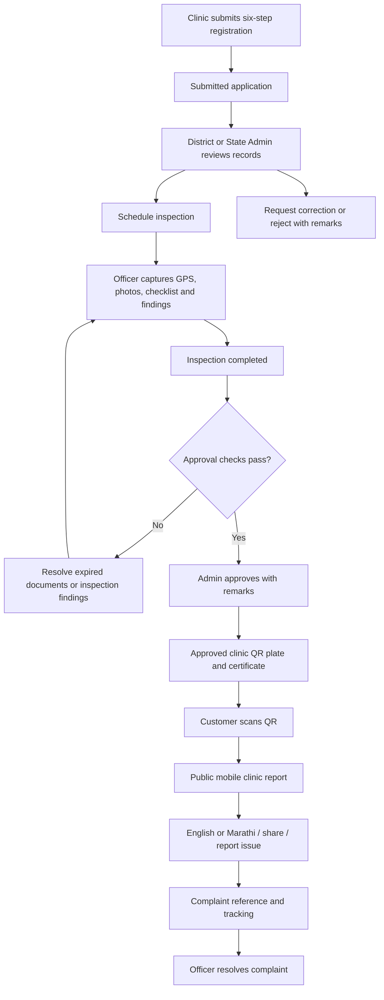

# MahaCare Registry — Demo Workflow Guide

Prepared: 26 October 2026  
Project: Maharashtra Diagnostic Centre Registry  
Purpose: A practical script for presenting the current working demo.

## 1. Demo introduction

“MahaCare connects clinic registration, document review, field inspection, administrative approval, and a public QR report. A customer scans the clinic QR code and opens the clinic details directly in a mobile browser.”

Use fictional demonstration records throughout. Approval shown in this prototype is a registry workflow status, not government verification or a licence. The public report describes the clinic; it is not a patient test report.

## 2. Start the project

From the project folder, run:

```powershell
cd C:\kajal\MRI
npm run dev
```

Open the address printed by the terminal. The examples below use **http://localhost:3000**. If the terminal chooses another port, use that port consistently.

Before presenting:

- Confirm the home page and sample clinic report load.
- Keep internet available for Google Translate and external map resources.
- Prepare fictional registration details, unexpired document dates, a sample document attachment, and an inspection photograph.
- Use a disposable demo clinic for registration and approval actions; retain the seeded clinic for a reliable QR demonstration.
- Use the same running server for the laptop and phone so they share records.

## 3. Screens and roles

| Screen | Link | Purpose |
| --- | --- | --- |
| Public website | http://localhost:3000/ | Project introduction and public navigation |
| Find a centre | http://localhost:3000/centres | Search and browse clinic records |
| Verify centre | http://localhost:3000/verify | Look up a centre for verification |
| Register centre | http://localhost:3000/register | Six-step application form |
| Role selection | http://localhost:3000/login | Select a demonstration workspace |
| Portal | http://localhost:3000/portal | Role-specific management screens |
| Field workspace entry | http://localhost:3000/field | Open the Officer workspace |
| Customer clinic report | http://localhost:3000/mobile/centres/MH-PUN-2024-001 | Mobile-friendly public report |
| Submit complaint | http://localhost:3000/complaint | Record a customer grievance |
| Track complaint | http://localhost:3000/complaint/track | Check a tracking reference |

The older `/centres/MH-PUN-2024-001` address redirects to the mobile clinic report.

| Role | What to demonstrate |
| --- | --- |
| State Admin | State-level dashboard, district filters, applications, approvals, documents, inspections, complaints, and QR plates |
| District Admin | Assigned district records, application review, inspection scheduling, and approval decisions |
| Officer | Field inspections, GPS, photographs, checklist, findings, and complaint resolution |
| Centre | Selected clinic details, application status, staff, equipment, documents, and QR plate after approval |
| Customer | Search, QR report, English/Marathi translation, complaint submission, and tracking without a portal login |

The login page is a demo role selector. It does not authenticate real government officers or clinic owners.

## 4. End-to-end workflow



The current demo assigns the clinic UDCID during application submission. Approval controls eligibility for the approved QR plate; it does not first create the UDCID.

## 5. Suggested live presentation — 15 to 20 minutes

### Step 1 — Show the customer experience first

1. Open the sample customer clinic report from the links above.
2. Explain that scanning a QR opens this page without a login or an app installation.
3. Show clinic name, address, contact actions, owner, last inspection, and approval status.
4. Use **Doctors & staff**, **Equipment**, and **Permits & QR** to jump through the report.
5. Show doctor qualifications, registration number, expiry date, technical staff, equipment, calibration date, and services.
6. Show permits with their individual expiry/validity badges. Explain that clinic approval and document validity are separate.
7. Select **मराठी** and then **EN** in the header. Google Translate requires internet; machine translation should not be presented as a certified translation.
8. Show the aligned **Report Issue** and **Share Profile** actions. Share Profile copies the report link when clipboard access is available.

Presenter line: “Customers can inspect the clinic record on their phone without downloading an app.”

### Step 2 — Submit a new clinic application

1. Open **Register Centre**.
2. Complete the six steps in order:
   - **Basic Details:** centre name, facility type, ownership, and contact details.
   - **Location:** address, district, taluka, and PIN code.
   - **Owner & Staff:** owner, doctor, and technical staff details.
   - **Services:** services and equipment information.
   - **Documents:** registration details, issuing authority, dates, and available attachment fields.
   - **Review:** verify the entered information before submitting.
3. Submit and record the displayed UDCID.
4. Open the administrator portal and locate the same clinic under **Applications**.

Expected result: The application appears as **Submitted**, with its linked documents and application history.

### Step 3 — Review and schedule an inspection

1. Open `/login` and choose **District Admin** or **State Admin**.
2. Open **Applications**, locate the new clinic, and choose **Review**.
3. Review details, staff, documents, and history.
4. Demonstrate the available decisions: schedule inspection, request correction, reject, or approve when eligible.
5. Schedule an inspection with a date and decision remarks.

Expected result: Clinic status becomes **Inspection Scheduled** and the workflow records the action.

### Step 4 — Complete the field inspection

1. Open `/field` and choose **Open inspector workspace**, or choose **Officer** from `/login`.
2. Find the scheduled clinic in **Field Inspections**.
3. Open the inspection form and capture device GPS.
4. Attach at least one inspection photograph.
5. Complete the safety checklist and enter inspection findings.
6. If follow-up is required, select the follow-up date.
7. Submit the report.

Expected result: A completed inspection is stored and the clinic moves to **Inspection Completed**.

GPS and camera access on phones require a secure HTTPS origin. A plain HTTP LAN address can show the public QR report but may not permit device GPS/camera capture. Use an HTTPS demo environment for a full phone inspection demonstration.

### Step 5 — Approve and generate the QR plate

1. Return to **District Admin** or **State Admin**.
2. Review the completed inspection and current documents.
3. Enter approval remarks and approve the application.
4. Open **QR Plate**, select the approved clinic, and show its QR plate and available PDF downloads.
5. Open the generated QR link and confirm the UDCID matches the selected clinic.

Approval requires:

- District Admin or State Admin role.
- Clinic status **Inspection Completed** and a completed inspection report.
- A nonempty checklist with no **Non-compliant** findings.
- No outstanding follow-up requirement.
- At least one registration document and no expired linked documents.
- Decision remarks in the review form.

Expected result: Clinic status becomes **Approved** and the approved clinic is available for QR plate selection.

### Step 6 — Scan with a real phone

1. Connect the phone and demo computer to the same Wi-Fi.
2. Display the selected clinic QR plate on the computer.
3. Inspect the encoded address: it must use the computer’s reachable LAN IP or a hosted HTTPS address, not `localhost` or `127.0.0.1`.
4. Scan with the phone camera and open the link.
5. Confirm the report displays the correct clinic and all sections fit the mobile screen.

The project attempts to detect a LAN address for QR links opened from localhost. For a hosted demo, configure `NEXT_PUBLIC_SITE_URL` with the intended public origin and restart the server. Test the generated link before the presentation; a VPN, firewall, or isolated Wi-Fi can prevent access.

The customer route is `/mobile/centres/{UDCID}`. The officer route is `/field`. These are separate browser links; the customer does not need the officer workspace.

### Step 7 — Demonstrate complaints and tracking

1. In the clinic report, select **Report Issue**.
2. Confirm the clinic is preselected and fill the required complaint fields with fictional data.
3. Submit and copy the generated tracking reference.
4. Open **Track Complaint** and enter that reference.
5. In the Officer portal, open **Complaints**, find the same record, and use **Mark Resolved** for the demo complaint.
6. Refresh the public tracking result and show the updated status and recorded timeline.

Expected result: Submission, officer action, and public tracking refer to the same complaint.

### Step 8 — Finish with monitoring

1. Open the State Admin dashboard.
2. Show KPI cards, district/facility filters, and charts using the current records.
3. Open **GIS Map** and demonstrate clinic locations.
4. Show **Documents** for expired/expiring records and **Inspections** for scheduled visits.
5. Demonstrate the available CSV export and explain that the displayed counts depend on current filters and demo data.

Presenter line: “The same registry supports customer transparency and administrative monitoring.”

## 6. Optional offline demonstration

1. Load the required workspace while connected first.
2. Disconnect the network only after the screen and records are available.
3. Perform a supported local update and show its pending sync status.
4. Reconnect and use the available sync/retry control if needed.
5. Refresh another browser connected to the same server to confirm the saved change.

The demo uses server-backed registry storage with device-side caching and an offline mutation queue. Do not promise that every unvisited page, Google Translate, map tile, or fresh QR scan works offline.

## 7. Quick checks before handing over

- [ ] Public website opens on the expected port.
- [ ] Sample QR report opens without a portal login.
- [ ] Phone QR address is reachable from the phone.
- [ ] English and Marathi controls work with internet access.
- [ ] Staff, equipment, permit details, and bottom buttons fit a narrow screen.
- [ ] Submitted clinic appears in the administrator application list.
- [ ] Inspection records include GPS, a photograph, checklist, and findings.
- [ ] Ineligible approval is blocked; eligible approval succeeds.
- [ ] Approved clinic QR plate points to the correct report.
- [ ] Complaint reference can be tracked and an Officer resolution appears.
- [ ] Exports and PDF downloads open for the selected clinic.

## 8. Troubleshooting during the demo

| Issue | Check / action |
| --- | --- |
| Site does not open | Confirm the dev server is running; use the terminal’s actual port. |
| Phone cannot open QR link | Check Wi-Fi, LAN IP, port, firewall, and `NEXT_PUBLIC_SITE_URL`; localhost refers to the phone itself. |
| GPS/camera is unavailable | Use HTTPS and allow the browser’s device permission when prompted. |
| Approval is blocked | Check completed inspection, follow-up, non-compliant findings, document expiry, role, and remarks. |
| Marathi does not load | Check internet access and Google Translate availability; return to EN and retry. |
| Another device shows old data | Reconnect, finish pending synchronization, and refresh against the same server. |
| A complaint is not found | Use the exact generated tracking reference from the same demo server. |

## 9. Scope to explain clearly

This is a demonstration application with fictional records and demo role selection. It does not currently prove government approval, validate credentials against live authorities, or provide production identity authentication. QR codes open registry records; they do not independently certify the authenticity of uploaded documents. Describe production authentication, verified integrations, and deployment hardening as future work rather than completed functionality.
