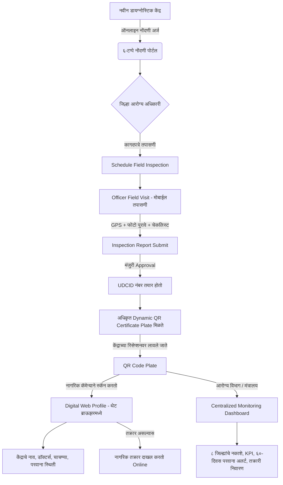

# 🏥 MahaCare Diagnostic Registry (महाराष्ट्र शासन प्रस्ताव)
### महाराष्ट्र राज्यातील डायग्नोस्टिक सेंटर्सची केंद्रीकृत नोंदणी, प्रमाणित QR कोड पडताळणी आणि मॉनिटरिंग प्रणाली

> **प्रकल्प हेतू:** महाराष्ट्र राज्यातील सर्व MRI सेंटर्स, CT Scan सेंटर्स, पॅथॉलॉजी लॅब्स, X-Ray आणि सोनोग्राफी केंद्रांची एकाच छताखाली डिजिटल नोंदणी करणे, रिसेप्शनवर अधिकृत **Dynamic QR Code Plate** बसवणे आणि **Centralized Monitoring Dashboard** द्वारे संपूर्ण राज्यावर नियंत्रण ठेवणे.

---

## 🎯 १. या प्रकल्पाचा मुख्य हेतू (Core Motive)

महाराष्ट्रात हजारो खाजगी व सरकारी डायग्नोस्टिक सेंटर्स कार्यरत आहेत. या केंद्रांवर विविध कडक कायदे व नियम लागू होतात:
1. **सोनोग्राफी सेंटर्स:** PCPNDT कायदा (गर्भलिंग निदान प्रतिबंध).
2. **X-Ray / CT Scan / MRI:** AERB (अणुऊर्जा नियामक मंडळ - रेडिएशन सुरक्षा नियम).
3. **पॅथॉलॉजी व लॅब्स:** बायोमेडिकल वेस्ट (BMW) कचरा विल्हेवाट व प्रदूषण नियंत्रण परवाना.
4. **डॉक्टर्स व तंत्रज्ञ:** महाराष्ट्र मेडिकल कौन्सिल (MMC) आणि राज्य पॅरा-मेडिकल बोर्डाची अधिकृत नोंदणी.

### ⚠️ सध्याची अडचण (Current Problem):
* नागरिकाला समजत नाही की आपण ज्या लॅबमध्ये तपासणी करत आहोत ती **अधिकृत (Govt. Approved)** आहे की बोगस? तिथली उपकरणे तपासलेली आहेत का?
* शासनाकडे संपूर्ण राज्यातील केंद्रांची, त्यांच्या परवान्यांची मुदत (Validity), आणि अधिकाऱ्यांच्या तपासणीचा एकाच ठिकाणी रिअल-टाइम डेटा उपलब्ध नाही.

### ✅ या प्रणालीचे उद्दिष्ट:
1. **नागरिकांसाठी पारदर्शकता:** केंद्राच्या काऊंटरवरील QR कोड स्कॅन करून एका सेकंदात केंद्राची वैधता तपासता येणे.
2. **शासनासाठी संपूर्ण नियंत्रण:** कोणत्या केंद्राचे परवाने संपत आले आहेत (६० दिवस अलर्ट), कोणती उपकरणे अनधिकृत आहेत हे डॅशबोर्डवर दिसणे.
3. **पारदर्शक तपासणी:** आरोग्य अधिकाऱ्यांनी प्रत्यक्ष केंद्रात जाऊन मोबाईलद्वारे GPS आणि फोटोंसह डिजिटल तपासणी करणे.

---

## 📱 २. प्रणालीचे २ मुख्य घटक (Two Main Components)

ही प्रणाली प्रामुख्याने **२ भागांमध्ये** विभागलेली आहे:

```
┌─────────────────────────────────────────────────────────────────────────────┐
│                           MahaCare Digital System                           │
├──────────────────────────────────────────────┬──────────────────────────────┤
│ १. Centralized Monitoring Dashboard          │ २. QR & Mobile Verification  │
│ (मंत्रालय, जिल्हा आरोग्य अधिकारी, क्लिनिक)    │ (नागरिक व तपासणी अधिकारी)     │
└──────────────────────────────────────────────┴──────────────────────────────┘
```

### घटक १: Centralized Monitoring Dashboard (वेब पोर्टल)
* मंत्रालय (State Admin), जिल्हा आरोग्य अधिकारी (District Admin), आणि केंद्रांसाठी संगणकावर चालणारा मोठा डॅशबोर्ड.
* **प्रमुख वैशिष्ट्ये:**
  * **८ रिअल-टाइम KPI कार्ड्स:** एकूण केंद्रे, मंजूर केंद्रे, प्रलंबित अर्ज, मुदत संपलेली कागदपत्रे, ६० दिवसांत संपणारे परवाने, नागरिकांच्या तक्रारी.
  * **५ विश्लेषणात्मक आलेख (Charts):** जिल्हावार केंद्रे, सुविधा प्रकार (MRI/CT), मासिक वाढ, कागदपत्र आरोग्य, तक्रार निवारण प्रमाण.
  * **GIS डिजिटल नकाशा (Leaflet Map):** महाराष्ट्राच्या नकाशावर सर्व केंद्रांचे अचूक पिन पॉइंट्स व फिल्टर्स.
  * **CSV एक्सपोर्ट:** एका क्लिकवर शासकीय रिपोर्ट एक्सेल/CSV मध्ये डाऊनलोड.

### घटक २: QR Code & Mobile Verification (नागरिक व तपासणी अधिकारी)

> ❓ **महत्त्वाचा प्रश्न: QR कोड स्कॅन झाल्यावर माहिती दिसण्यासाठी नागरिकांना Mobile App ची गरज आहे का?**
>
> **उत्तर: नाही! सामान्य नागरिकांसाठी कोणत्याही ॲपची (Mobile App) अजिबात गरज नाही.**

* **नागरिकांसाठी (Citizen Flow - Zero App Needed):**
  * नागरिक त्यांच्या मोबाईलमधील साध्या **कॅमेऱ्याने, Google Lens, किंवा Paytm/PhonePe/WhatsApp** च्या कोणत्याही QR स्कॅनरने केंद्राचा QR कोड स्कॅन करू शकतात.
  * स्कॅन करताच थेट मोबाईल ब्राऊझरमध्ये केंद्राचे **अधिकृत डिजिटल प्रोफाईल (Web Page)** उघडते.
  * त्यामुळे नागरिकांना ॲप डाऊनलोड करण्याचा त्रास होत नाही.

* **मोबाईल ॲप कोणासाठी आहे? (Officer Mobile Application):**
  * प्रस्तावाच्या पान ३ नुसार, मोबाईल ॲप/मोबाईल व्ह्यू हे **केवळ सरकारी तपासणी अधिकाऱ्यांसाठी (Health Inspectors)** आहे.
  * अधिकारी जेव्हा प्रत्यक्ष केंद्रात तपासणीसाठी जातात, तेव्हा त्यांना:
    1. केंद्राचा QR स्कॅन करणे.
    2. प्रत्यक्ष जागेवर हजर असल्याचा **GPS Location (अक्षांश-रेखांश)** नोंदवणे.
    3. क्लिनिक, मशिनरी आणि फलकांचे **कॅमेऱ्याने थेट फोटो** काढणे.
    4. जागेवरच सुरक्षा चेकलिस्ट भरून डिजिटल रिपोर्ट सबमिट करणे.

---

## 🔄 ३. संपूर्ण सिस्टीमचा एंड-टू-एंड फ्लो (User Flow)



---

## 🎬 ४. डेमो सादरीकरणाचा स्टेप-बाय-स्टेप प्लॅन (Demo Presentation Plan)

डेमो देताना पुढील ५ पायऱ्या दाखवाव्यात:

### पायरी १: नागरिकाचा अनुभव (Citizen QR Scan)
1. केंद्राच्या रिसेप्शनवर लागलेली **QR Certificate Plate** दाखवा.
2. मोबाईल कॅमेऱ्याने किंवा थेट लिंकने ओपन करा: `http://localhost:3000/centres/MH-PUN-2024-001`
3. **काय स्पष्ट करायचे:**
   * ॲपशिवाय थेट ब्राऊझरमध्ये माहिती उघडली.
   * केंद्राचे नाव, पत्ता, उपलब्ध चाचण्या (MRI/CT), डॉक्टर आणि उपकरणांची माहिती.
   * **Approved** कायदेशीर दर्जा आणि AERB/PCPNDT परवान्याची मुदत.

### पायरी २: नागरिक तक्रार व ट्रॅकिंग (Grievance Redressal)
1. `/complaint` पृष्ठावर जाऊन सेवेबाबत ऑनलाइन तक्रार दाखल करा.
2. तक्रार दाखल होताच मिळणारा युनिक नंबर पहा (उदा. `CMP-2024-00142`).
3. `/complaint/track` वर जाऊन तपासणी अधिकाऱ्याने केलेली कारवाई व टाइमलाइन ट्रॅक करून दाखवा.

### पायरी ३: तपासणी अधिकारी फ्लो (Officer Mobile Inspection)
1. `/portal` वर जाऊन **"Officer"** (पुणे जिल्हा आरोग्य अधिकारी) रोल निवडा.
2. **"Conduct Field Inspection"** बटण दाबून ७-टप्प्यांची तपासणी दाखवा:
   * **टप्पा १:** केंद्र निवड.
   * **टप्पा २:** **GPS Geolocation** पडताळणी (< १५ मीटर सॅटेलाइट अचूकता).
   * **टप्पा ३:** कागदपत्रे तपासणी (AERB, बायोमेडिकल वेस्ट, ट्रेड लायसन्स).
   * **टप्पा ४:** सुरक्षा चेकलिस्ट (रेडिएशन शिल्डिंग, आपत्कालीन औषधे, डॉक्टर उपस्थिती).
   * **टप्पा ५:** जिओ-टॅग फोटो पुरावे अपलोड.
   * **टप्पा ६:** अधिकाऱ्याचे शेरे व पुढील तारीख.
   * **टप्पा ७:** डिजिटल स्वाक्षरी व सबमिशन.

### पायरी ४: मंत्रालय व राज्य डॅशबोर्ड (Centralized Monitoring Dashboard)
1. रोल बदलून **"State Admin"** (मंत्रालय, मुंबई) निवडा.
2. **८ KPI कार्ड्स** आणि **५ थेट आलेख** दाखवा.
3. **GIS नकाशा (Leaflet Map):** महाराष्ट्राच्या नकाशावर सर्व जिल्ह्यांमधील केंद्रांचे पिन पॉइंट्स व फिल्टर्स दाखवा.
4. **६०-दिवस परवाना अलर्ट:** ज्या केंद्रांचे परवाने पुढील ६० दिवसांत संपणार आहेत त्यांची स्वतंत्र यादी.
5. **CSV एक्सपोर्ट:** एका क्लिकवर संपूर्ण डेटा डाऊनलोड करून दाखवा.

### पायरी ५: डायग्नोस्टिक केंद्र पोर्टल (Centre Workspace)
1. **"Centre"** रोल निवडा (सह्याद्री MRI, पुणे).
2. **"QR Plate"** मेनू उघडून शासकीय मानकाप्रमाणे तयार झालेले **प्रमाणपत्र (Certificate)** दाखवा.
3. **"Print Certificate Plate"** बटण दाबून रिसेप्शनवर लावण्यासाठी तयार प्रिंट लेआऊट दाखवा.
4. नवीन डॉक्टर किंवा मशिनरी नोंदवण्याचा फ्लो दाखवा.

---

## 📊 ५. डेमोसाठी वापरलेला अस्सल महाराष्ट्र डेटा (Realistic Demo Data)

| घटक | डेमो डेटा तपशील |
|---|---|
| **केंद्राचे नाव** | सह्याद्री MRI आणि डायग्नोस्टिक सेंटर, पुणे |
| **युनिक आयडी (UDCID)** | `MH-PUN-2024-001` (translate="no") |
| **पत्ता** | गाळा क्र. १४, विठ्ठल नगर, पुणे-सातारा रस्ता, हवेली, पुणे - ४११०४१ |
| **मुख्य डॉक्टर** | डॉ. प्रिया कुलकर्णी (MBBS, MD Radiology) - MMC Reg: `MCI-2009-MH-04821` |
| **मुख्य तंत्रज्ञ** | राकेश पवार (DMLT) - महाराष्ट्र पॅरा-मेडिकल बोर्ड Reg: `MPTB-2018-04211` |
| **मशिनरी** | Siemens 1.5T Superconducting MRI (कॅलिब्रेशन वैध) |
| **परवाने** | AERB क्लिअरन्स, अग्निशामक सुरक्षा NOC, बायोमेडिकल वेस्ट करार |
| **तक्रार ट्रॅकिंग** | `CMP-2024-00142` (Under Investigation) |

---

## 🛠️ ६. तांत्रिक माहिती (Tech Stack)

* **Framework:** Next.js 16 (App Router) + React 19
* **Language & Styling:** TypeScript + Tailwind CSS 4 & Vanilla CSS
* **QR Engine:** `qrcode.react` (Dynamic SVG)
* **Analytics Charts:** Recharts (v2.15)
* **GIS Mapping:** Leaflet & OpenStreetMap (महाराष्ट्र अक्षांश-रेखांश)
* **Data Persistence:** Browser `localStorage` (रीलोड केल्यावरही डेटा टिकून राहतो)

---

## 🚀 ७. ॲप्लिकेशन कसे चालवायचे (How to Run)

१. लायब्ररी इन्स्टॉल करा:
```bash
npm install
```

२. डेव्हलपमेंट सर्व्हर सुरू करा:
```bash
npm run dev
```

३. ब्राऊझरमध्ये उघडा:
* मुख्य वेबसाईट: [http://localhost:3000](http://localhost:3000)
* सेंटर्स डिरेक्टरी: [http://localhost:3000/centres](http://localhost:3000/centres)
* नमुना QR प्रोफाईल: [http://localhost:3000/centres/MH-PUN-2024-001](http://localhost:3000/centres/MH-PUN-2024-001)
* तक्रार नोंदणी व ट्रॅकिंग: [http://localhost:3000/complaint](http://localhost:3000/complaint)
* सेंट्रलाइज्ड डॅशबोर्ड व पोर्टल: [http://localhost:3000/portal](http://localhost:3000/portal)
# MRI

